# Billing System User Journeys

This document visualizes the user journeys and backend processes for Quizify's hybrid credit-based billing system.

> **Last Updated**: After migrations 031 & 032 - Split free/paid credit buckets + Atomic operations

## System Overview

The billing system uses a **3-bucket credit architecture** with **atomic operations** to prevent race conditions:

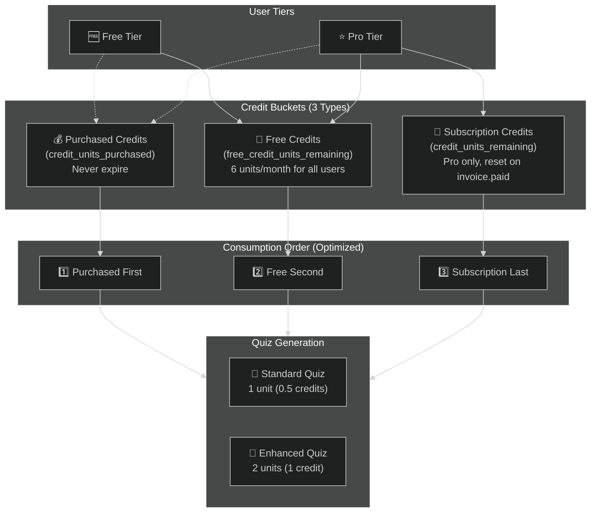

> **Key Change (Migration 032)**: Consumption order is now `Purchased → Free → Subscription` to preserve paid subscription credits longest.

## Credit Bucket Reference

### Buckets by Tier

| Bucket | Free Tier | Pro Tier | Reset Mechanism |
|--------|-----------|----------|-----------------|
| **Purchased** (`credit_units_purchased`) | ✅ Can buy | ✅ Can buy | Never resets |
| **Free** (`free_credit_units_remaining`) | 6 units/month | 6 units/month | Cron job (free users) / `invoice.paid` (Pro users) |
| **Subscription** (`credit_units_remaining`) | ❌ N/A | 60 units/month | `invoice.paid` webhook |

### Consumption Priority (Updated)

| Priority | Bucket | Rationale |
|----------|--------|-----------|
| 1️⃣ First | Purchased | Use one-time purchases first (never expire anyway) |
| 2️⃣ Second | Free | Use free allowance before paid subscription |
| 3️⃣ Last | Subscription | Preserve paid subscription credits longest |

### Unit Costs

| Item | Units | Credits |
|------|-------|---------|
| Standard Quiz | 1 unit | 0.5 credits |
| Enhanced Quiz | 2 units | 1 credit |

### Credit Packs (One-time Purchase)

| Pack Size | Units | Price ID Config |
|-----------|-------|-----------------|
| 10 credits | 20 units | `STRIPE_PRICE_ID_CREDITS_10` |
| 30 credits | 60 units | `STRIPE_PRICE_ID_CREDITS_30` |
| 100 credits | 200 units | `STRIPE_PRICE_ID_CREDITS_100` |

---

## Free Tier User Journey

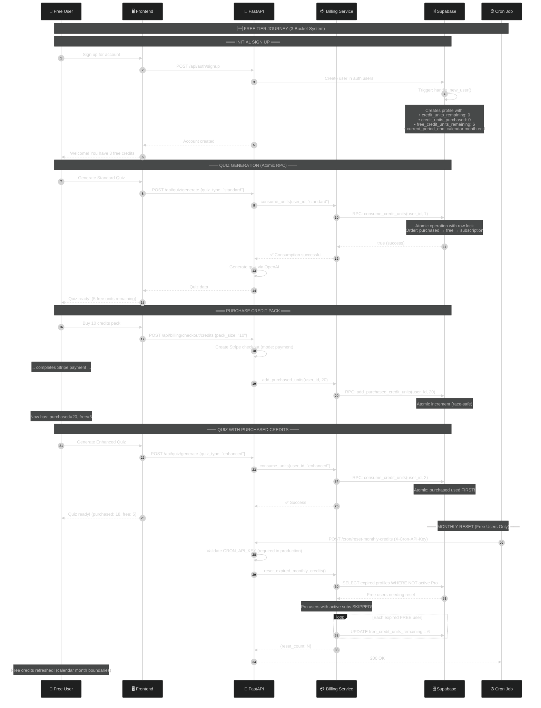

---

## Pro Tier User Journey

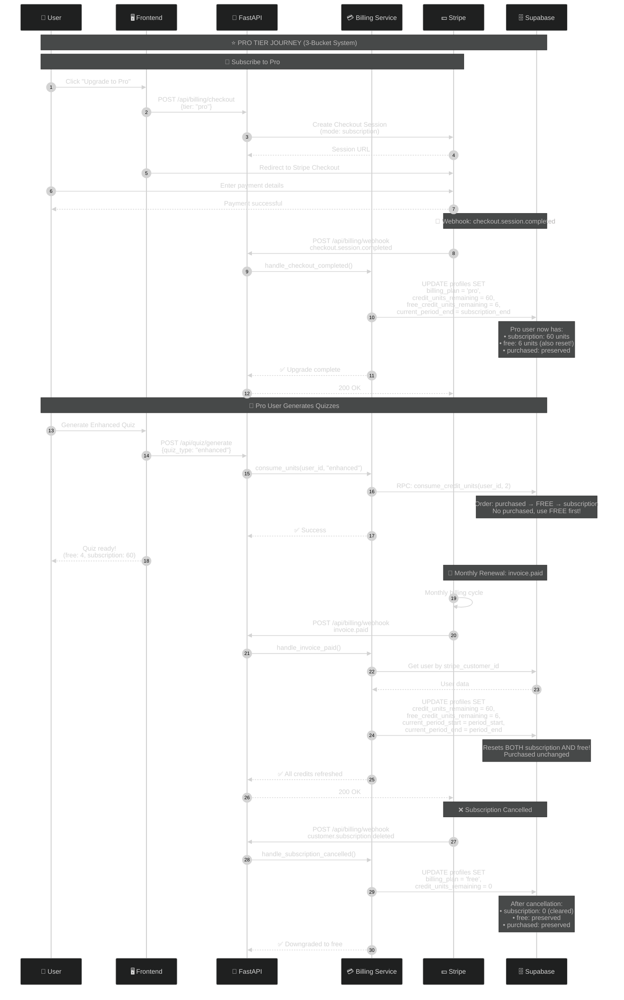

---

## Credit Pack Purchase Flow

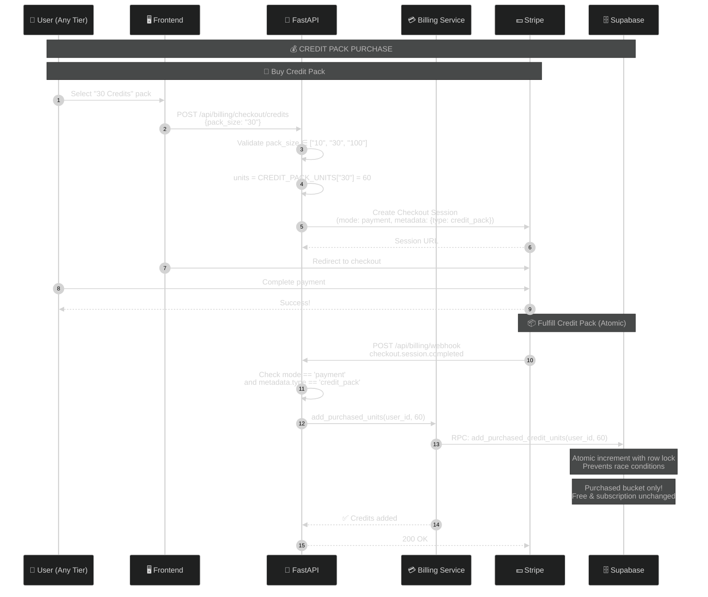

---

## Credit Consumption Logic (Atomic RPC)

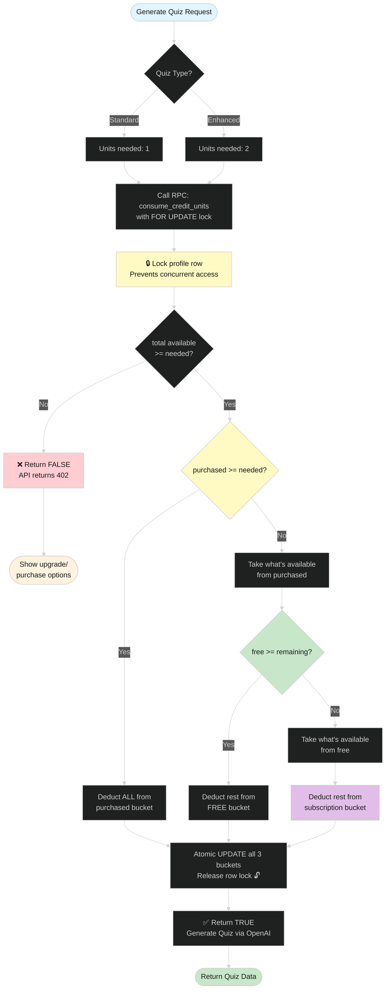

> **Key Improvement (Migration 032)**: All credit operations now use PostgreSQL RPCs with `FOR UPDATE` row locking to prevent double-spending under concurrent load.

---

## Tier Comparison (3-Bucket)

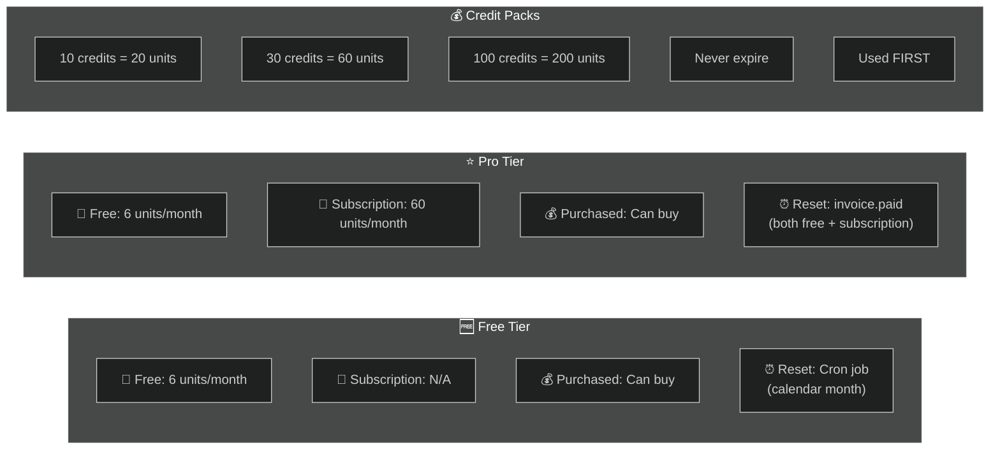

---

## Monthly Reset Scenarios

This section documents all credit reset scenarios and how they're handled:

### Scenario Matrix

| User Type | Reset Trigger | What Resets | Period Handling |
|-----------|---------------|-------------|-----------------|
| **Free user** (expired period) | Cron job | `free_credit_units_remaining` → 6 | Calendar month boundaries |
| **Free user** (null period) | Cron job | `free_credit_units_remaining` → 6 | Sets calendar month boundaries |
| **Pro user** (active sub) | `invoice.paid` webhook | Both `free` (→6) AND `subscription` (→60) | Stripe period dates |
| **Pro user** (trialing) | `invoice.paid` webhook | Both `free` (→6) AND `subscription` (→60) | Stripe period dates |
| **Cancelled Pro** (now free) | Cron job | `free_credit_units_remaining` → 6 | Calendar month boundaries |
| **New signup** | Trigger: `handle_new_user()` | Initial: `free` = 6, `subscription` = 0 | Calendar month start → next month |

### Reset Flow Diagram

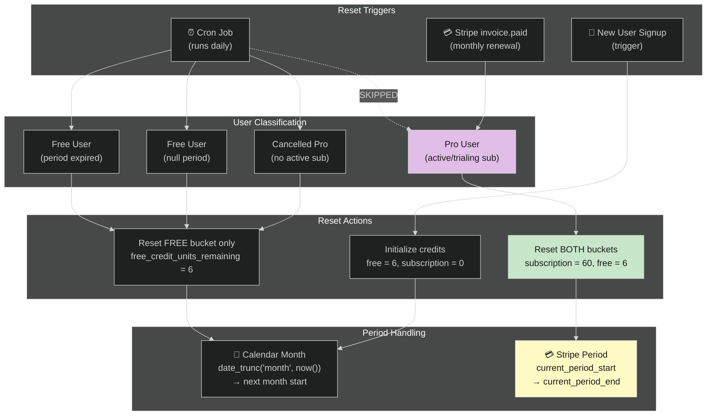

### Detailed Scenarios

#### 1️⃣ Free User Monthly Reset (Cron)

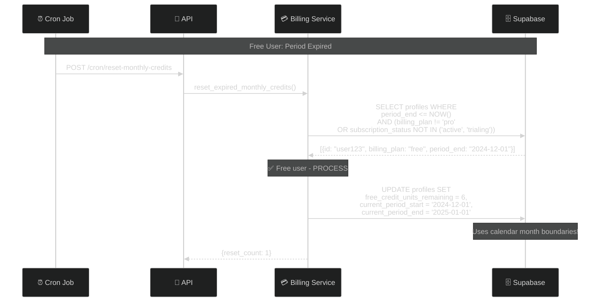

#### 2️⃣ Pro User Monthly Reset (Stripe Webhook)

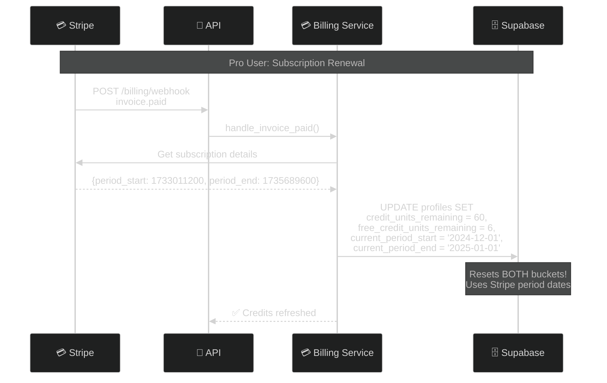

#### 3️⃣ Pro User Skipped by Cron

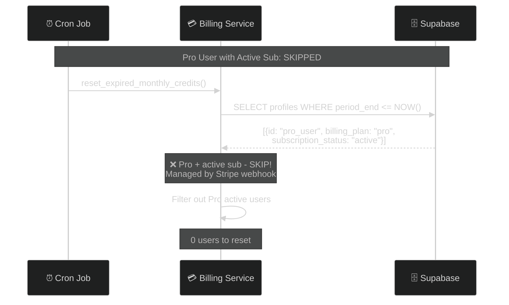

#### 4️⃣ Cancelled Pro User (Now Free)

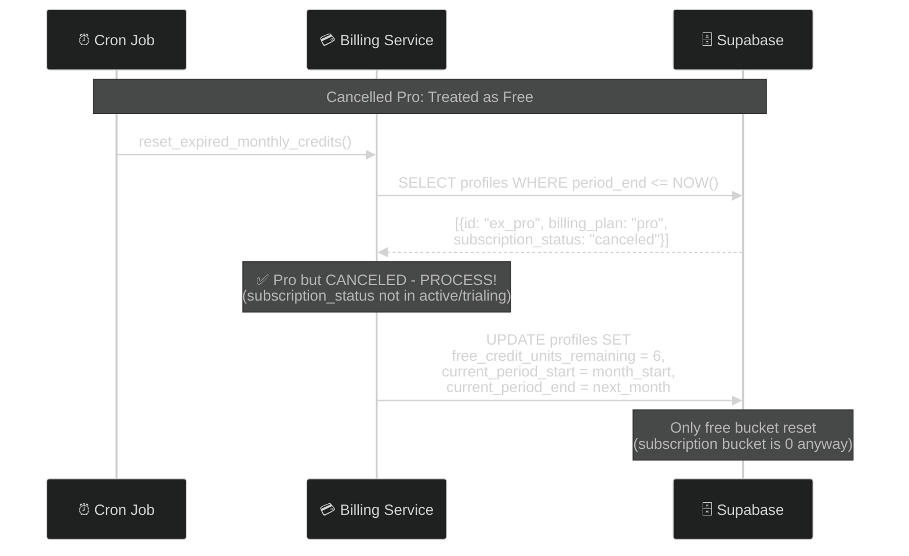

---

## Reset Mechanisms Summary

| Bucket | Free Users | Pro Users (Active) | Pro Users (Cancelled) |
|--------|------------|--------------------|-----------------------|
| **Free** | Cron → 6 | `invoice.paid` → 6 | Cron → 6 |
| **Subscription** | N/A (always 0) | `invoice.paid` → 60 | N/A (cleared on cancel) |
| **Purchased** | Never resets | Never resets | Never resets |
| **Period Source** | Calendar month | Stripe period | Calendar month |

### Cron Job Flow (Free Credits Reset - Free Users Only)

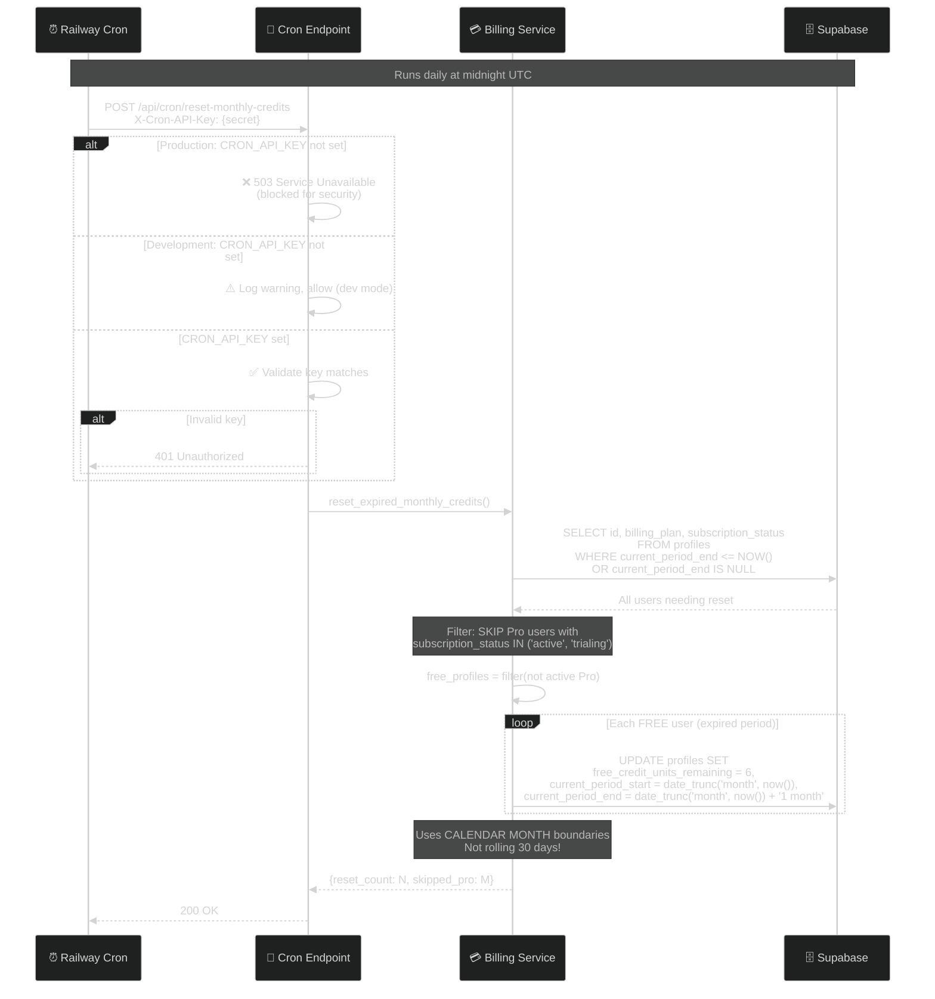

---

## Stripe Webhook Events

| Event | Mode | Handler | Action |
|-------|------|---------|--------|
| `checkout.session.completed` | subscription | `handle_checkout_completed` | Set `billing_plan='pro'`, `credit_units_remaining=60`, `free_credit_units_remaining=6` |
| `checkout.session.completed` | payment | `handle_credit_pack_purchase` | Atomic add to `credit_units_purchased` via RPC |
| `invoice.paid` | - | `handle_invoice_paid` | Reset BOTH `credit_units_remaining=60` AND `free_credit_units_remaining=6` |
| `customer.subscription.deleted` | - | `handle_subscription_cancelled` | Set `billing_plan='free'`, `credit_units_remaining=0` |

---

## Database Schema (After Migrations 031 & 032)

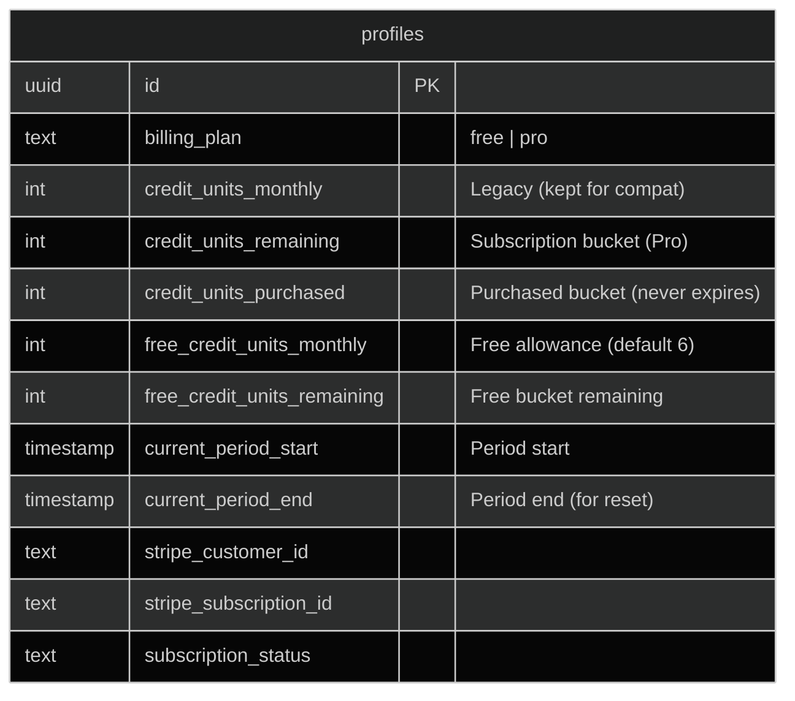

### Key Column Descriptions

| Column | Purpose | Reset By |
|--------|---------|----------|
| `credit_units_remaining` | Pro subscription credits (60/month) | `invoice.paid` webhook |
| `credit_units_purchased` | One-time purchased credits | Never resets |
| `free_credit_units_remaining` | Free monthly allowance | Cron job |
| `free_credit_units_monthly` | Monthly free allowance amount (default 6) | Manual only |
| `current_period_end` | When to reset free credits | Updated on reset |

---

## API Response: `/api/billing/balance`

```json
{
  "plan": "free",
  "credits_remaining": 8.0,
  "free_credits_monthly": 3.0,
  "free_credits_remaining": 3.0,
  "subscription_credits_remaining": 0.0,
  "purchased_credits": 5.0,
  "period_end": "2025-01-09T00:00:00Z"
}
```

### Response Fields

| Field | Description |
|-------|-------------|
| `plan` | Current billing plan (`free` or `pro`) |
| `credits_remaining` | Total across all buckets (for UI display) |
| `free_credits_monthly` | Monthly free allowance (always 3 credits) |
| `free_credits_remaining` | Remaining in free bucket |
| `subscription_credits_remaining` | Remaining in subscription bucket (Pro only) |
| `purchased_credits` | Remaining in purchased bucket |
| `period_end` | When free credits reset |

---

## Configuration Reference

### Environment Variables

| Variable | Purpose | Required |
|----------|---------|----------|
| `STRIPE_SECRET_KEY` | Stripe API authentication | ✅ |
| `STRIPE_WEBHOOK_SECRET` | Webhook signature verification | ✅ |
| `STRIPE_PRICE_ID_PRO` | Pro subscription price ID | ✅ |
| `STRIPE_PRICE_ID_CREDITS_10` | 10-credit pack price ID | ✅ |
| `STRIPE_PRICE_ID_CREDITS_30` | 30-credit pack price ID | ✅ |
| `STRIPE_PRICE_ID_CREDITS_100` | 100-credit pack price ID | ✅ |
| `CRON_API_KEY` | Cron endpoint authentication | ✅ Required in production |

### API Endpoints

| Endpoint | Method | Purpose |
|----------|--------|---------|
| `/api/billing/balance` | GET | Get detailed credit balance (3 buckets) |
| `/api/billing/checkout` | POST | Create Pro subscription checkout |
| `/api/billing/checkout/credits` | POST | Create credit pack checkout |
| `/api/billing/webhook` | POST | Handle Stripe webhooks |
| `/api/cron/reset-monthly-credits` | POST | Reset expired free credits (FREE users only) |

---

## Migration Notes

### Migration 031 - Split Free/Paid Buckets

1. **New columns added to `profiles`**:
   - `free_credit_units_monthly` (default 6)
   - `free_credit_units_remaining` (default 6)

2. **Existing data redistributed**:
   - Total units preserved
   - Up to 6 units moved to free bucket
   - Remainder stays in subscription bucket

3. **Period windows ensured**:
   - Null `current_period_start`/`end` backfilled with calendar month boundaries

4. **Trigger updated**:
   - `handle_new_user()` now seeds all 3 buckets
   - Uses calendar month boundaries (not rolling 30 days)

5. **View refreshed**:
   - `user_tier_info.monthly_credits` now correctly reports:
     - Pro: (60 + 6) / 2 = **33 credits/month**
     - Free: 6 / 2 = **3 credits/month**

### Migration 032 - Atomic Credit Operations

1. **New RPC functions**:
   - `consume_credit_units(user_id, units)` - Atomic debit with row lock
   - `add_purchased_credit_units(user_id, units)` - Atomic increment

2. **Security**:
   - Functions restricted to `service_role` only
   - Checks JWT claim, `current_user`, and `session_user`
   - Prevents any authenticated user from calling directly

3. **Consumption priority fixed**:
   - Order: `Purchased → Free → Subscription`
   - Preserves paid subscription credits longest

4. **Race condition prevention**:
   - Uses `FOR UPDATE` row locking
   - Concurrent quiz starts cannot double-spend

---

## Security Improvements

### RPC Access Control

```sql
-- Only service_role can call these functions
v_is_service_role := (
    v_caller_role = 'service_role' OR
    current_user = 'service_role' OR
    session_user IN ('postgres', 'service_role')
);

IF NOT v_is_service_role THEN
    RAISE EXCEPTION 'Access denied: requires service_role';
END IF;
```

### Cron Endpoint Protection

| Environment | `CRON_API_KEY` Set | Behavior |
|-------------|-------------------|----------|
| Production | ❌ No | 503 Service Unavailable (blocked) |
| Production | ✅ Yes | Validates key, 401 if invalid |
| Development | ❌ No | ⚠️ Allows with warning (intentional) |
| Development | ✅ Yes | Validates key normally |

---

## Checklist: Scenarios Handled ✅

| Scenario | Status | Implementation |
|----------|--------|----------------|
| Free user monthly reset | ✅ | Cron job with calendar month boundaries |
| Pro user monthly reset | ✅ | `invoice.paid` webhook resets both buckets |
| Pro free credits reset | ✅ | Reset alongside subscription on `invoice.paid` |
| Cancelled Pro reset | ✅ | Cron job handles (not active/trialing) |
| New user initialization | ✅ | Trigger sets calendar month period |
| Concurrent quiz prevention | ✅ | Atomic RPC with `FOR UPDATE` lock |
| Credit pack race condition | ✅ | Atomic increment RPC |
| Pro skipped by cron | ✅ | Filter excludes active/trialing subs |
| Period drift prevention | ✅ | Calendar month boundaries everywhere |
| Cron security in prod | ✅ | Requires `CRON_API_KEY`, blocks if unset |
| RPC security | ✅ | Restricted to service_role only |
| Monthly credits view | ✅ | Pro shows 33, Free shows 3 |
