# Quiz Generation Data Flow

This document provides comprehensive Mermaid diagrams showing how data flows from the frontend through quiz generation for both Standard and Enhanced modes.

## Table of Contents
1. [High-Level Overview](#high-level-overview)
2. [Frontend to Backend Flow](#frontend-to-backend-flow)
3. [Standard Mode Pipeline](#standard-mode-pipeline)
4. [Enhanced Mode Pipeline](#enhanced-mode-pipeline)
5. [Service Interactions](#service-interactions)
6. [Database Schema](#database-schema)

---

## High-Level Overview

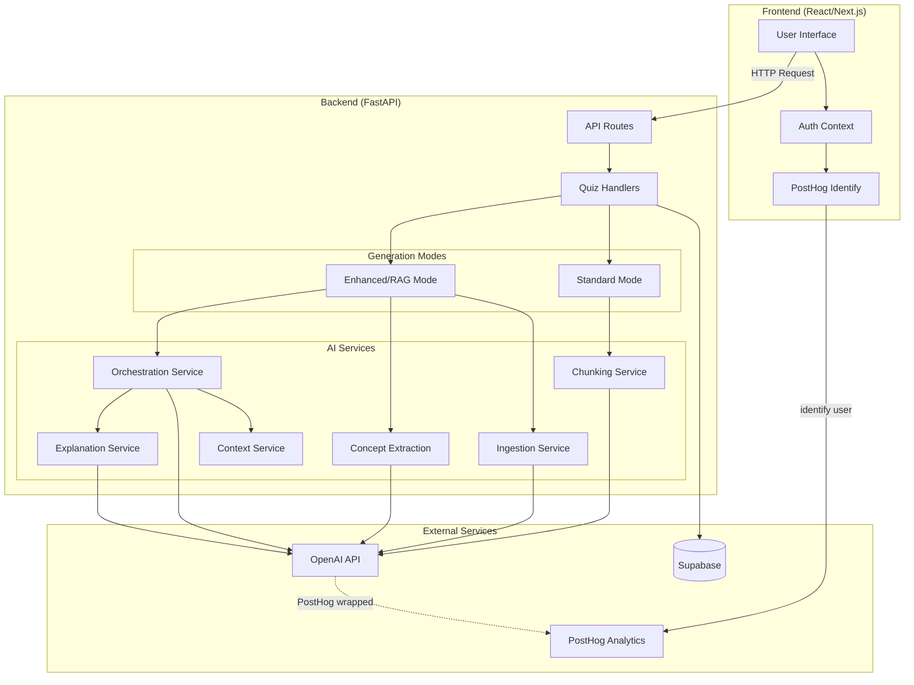

---

## Frontend to Backend Flow

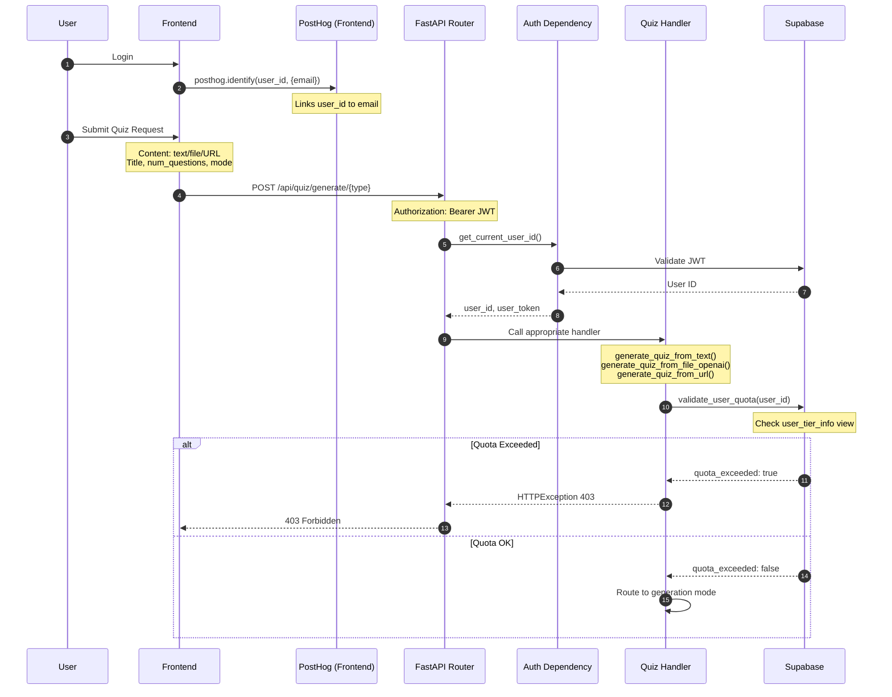

---

## Standard Mode Pipeline

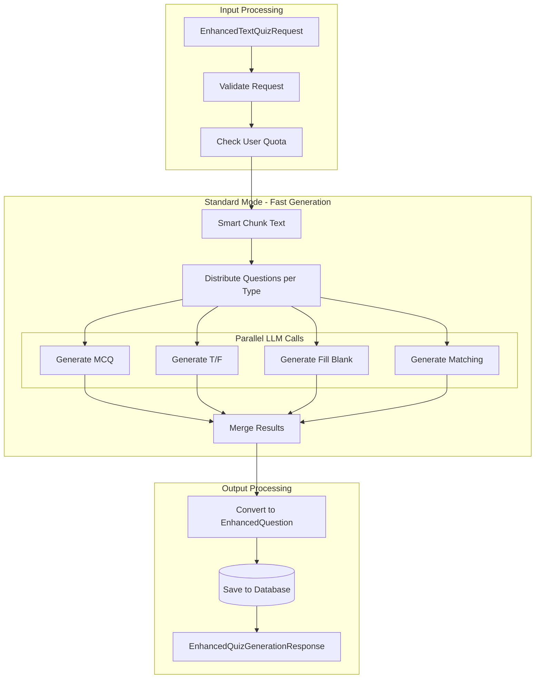

### Standard Mode Detailed Sequence

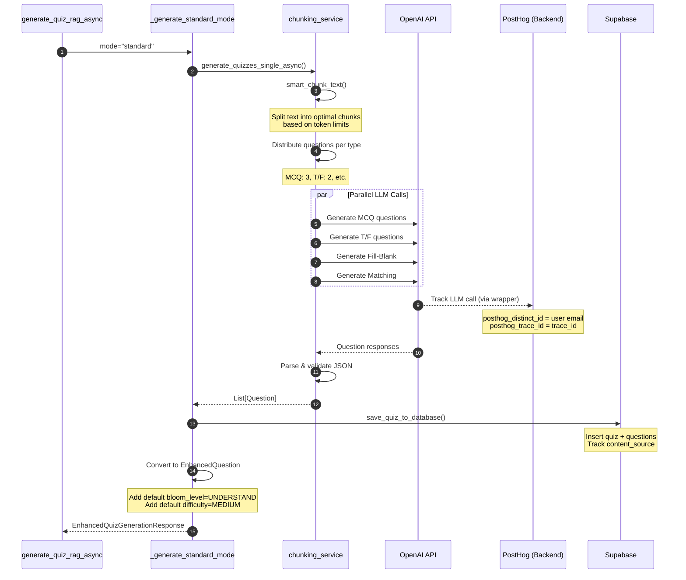

---

## Enhanced Mode Pipeline

```mermaid
flowchart TB
    subgraph Input["Input Processing"]
        Request[EnhancedTextQuizRequest]
        Validate[Validate Request]
        QuotaCheck[Check User Quota]
    end
    
    subgraph RAG["RAG Pipeline"]
        subgraph Ingestion["1. Ingestion"]
            CreateDoc[Create Document Record]
            LlamaChunk[LlamaIndex SentenceSplitter]
            Embed1[Generate Embeddings]
            SaveChunks[(Save Chunks + Vectors)]
        end
        
        subgraph Extraction["2. Concept Extraction"]
            direction TB
            ParallelExtract[Parallel Chunk Processing]
            LLMExtract[GPT-4o-mini Extract Concepts]
            Embed2[Generate Concept Embeddings]
            SaveConcepts[(Save Concepts)]
        end
        
        subgraph Selection["3. Concept Selection"]
            RankConcepts[Rank by Relevance]
            SelectTop[Select Top N Concepts]
            AssignTypes[Assign Question Types]
            AssignBloom[Assign Bloom Levels]
        end
        
        subgraph Generation["4. Question Generation"]
            direction TB
            ParallelGen[Parallel Question Gen]
            GetContext[Context Service]
            LLMGen[GPT-4o Generate Question]
            VerifyExplain[Verify + Explain]
        end
    end
    
    subgraph Output["Output Processing"]
        BuildQuestions[Build EnhancedQuestions]
        SaveDB[(Save to Database)]
        Response[EnhancedQuizGenerationResponse]
    end
    
    Request --> Validate
    Validate --> QuotaCheck
    QuotaCheck --> CreateDoc
    CreateDoc --> LlamaChunk
    LlamaChunk --> Embed1
    Embed1 --> SaveChunks
    SaveChunks --> ParallelExtract
    ParallelExtract --> LLMExtract
    LLMExtract --> Embed2
    Embed2 --> SaveConcepts
    SaveConcepts --> RankConcepts
    RankConcepts --> SelectTop
    SelectTop --> AssignTypes
    AssignTypes --> AssignBloom
    AssignBloom --> ParallelGen
    ParallelGen --> GetContext
    GetContext --> LLMGen
    LLMGen --> VerifyExplain
    VerifyExplain --> BuildQuestions
    BuildQuestions --> SaveDB
    SaveDB --> Response
```

### Enhanced Mode Detailed Sequence

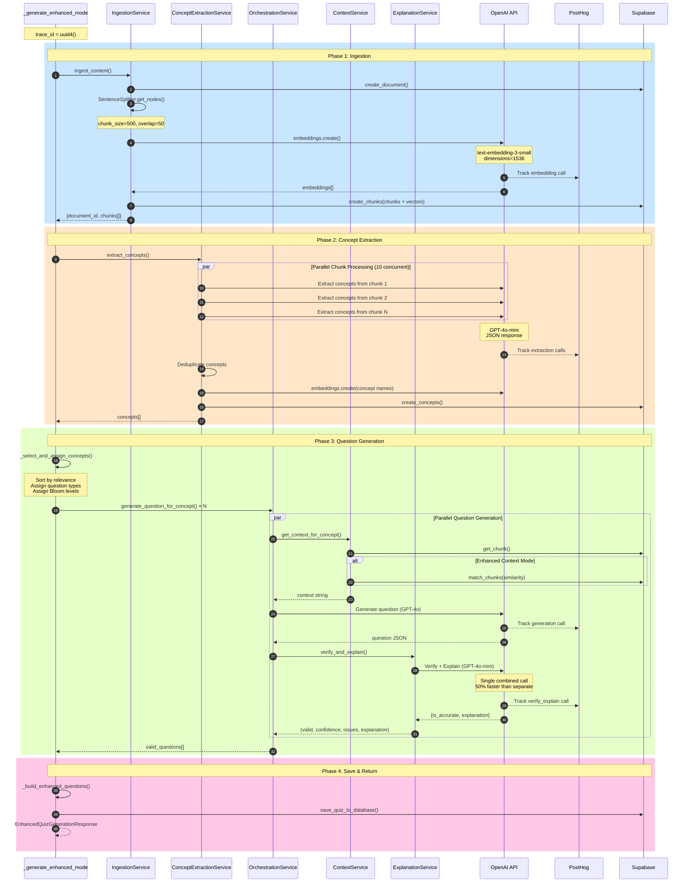

---

## Service Interactions

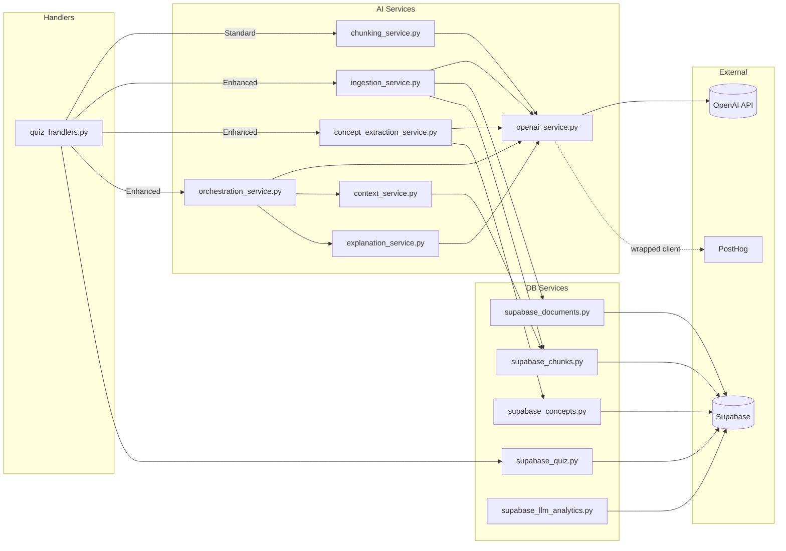

---

## Database Schema

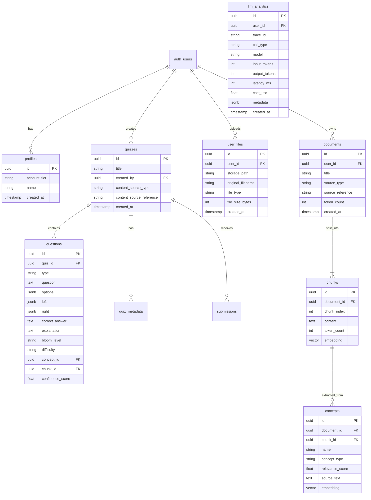

---

## LLM Calls Summary

### Standard Mode
| Step | Model | Purpose | Tokens (avg) |
|------|-------|---------|--------------|
| 1 | gpt-4o | Generate questions (parallel per type) | ~2000 in, ~500 out |

**Total: 1 LLM call per question type** (~4 calls for mixed)

### Enhanced Mode
| Step | Model | Purpose | Tokens (avg) |
|------|-------|---------|--------------|
| 1 | text-embedding-3-small | Embed chunks | ~500 per chunk |
| 2 | gpt-4o-mini | Extract concepts (per chunk) | ~600 in, ~200 out |
| 3 | text-embedding-3-small | Embed concept names | ~50 per concept |
| 4 | gpt-4o | Generate question (per concept) | ~800 in, ~300 out |
| 5 | gpt-4o-mini | Verify + Explain (per question) | ~400 in, ~150 out |

**Total: 2-3 LLM calls per question** (Generation + Verify/Explain combined)

---

## PostHog Analytics Flow

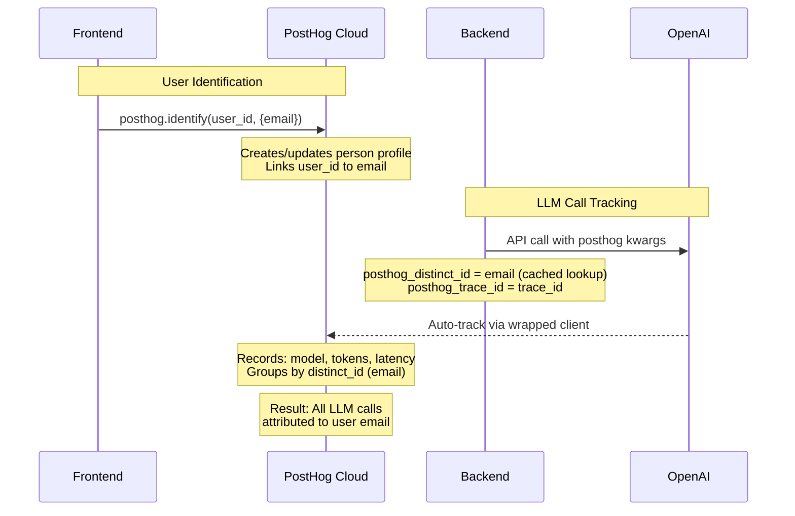

---

## Input Sources

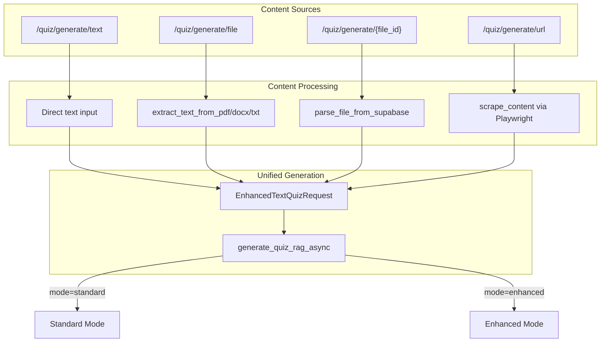

---

## Error Handling

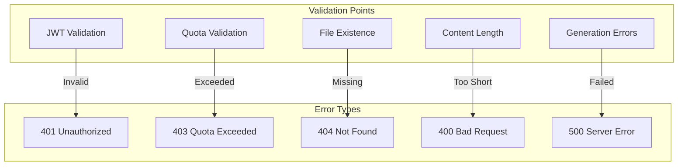

---

## Summary

| Aspect | Standard Mode | Enhanced Mode |
|--------|--------------|---------------|
| **Speed** | Fast (~5-10s) | Slower (~30-60s) |
| **LLM Calls** | 1 per type (~4 total) | 2-3 per question |
| **Context** | Full text chunked | RAG-retrieved context |
| **Bloom Levels** | Default (UNDERSTAND) | Distributed (all 6) |
| **Difficulty** | Default (MEDIUM) | Distributed (easy/medium/hard) |
| **Verification** | None | GPT-4o-mini verify+explain |
| **Cost** | ~$0.01-0.02 | ~$0.05-0.15 |
| **Quality** | Good | Higher (verified) |
