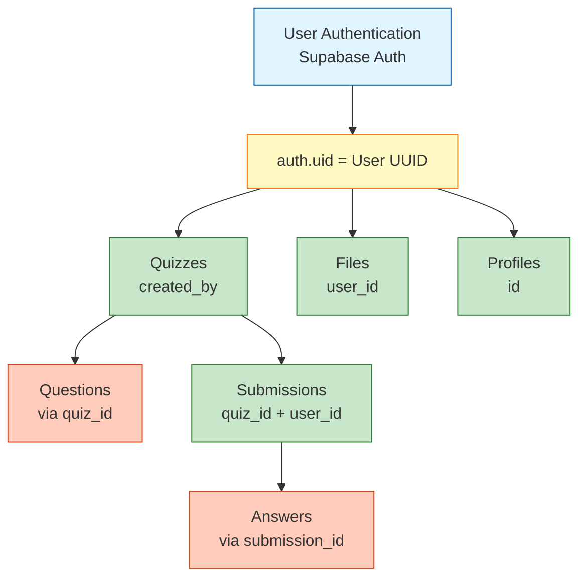
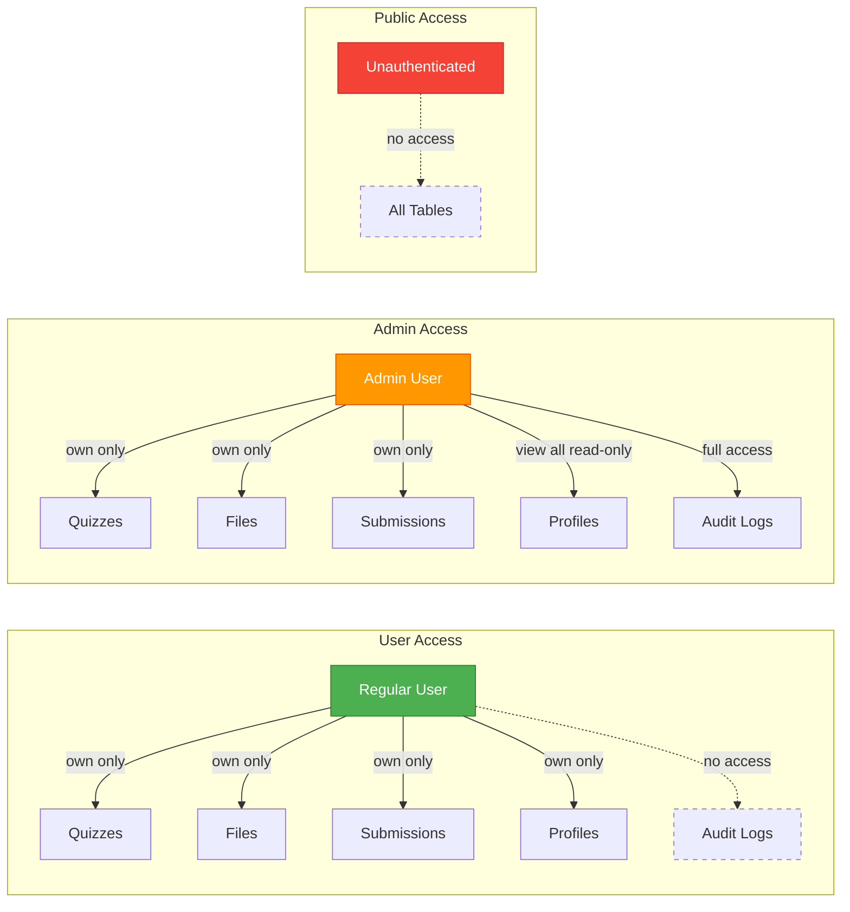
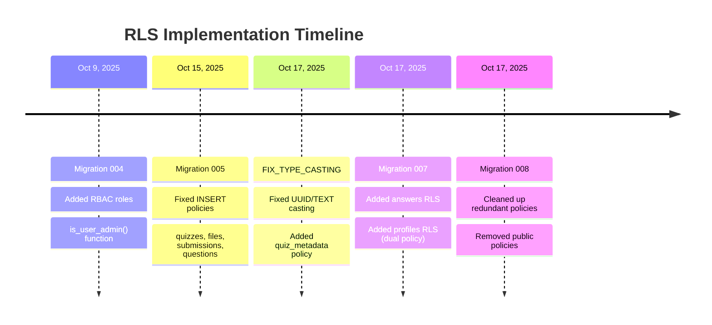

# Row Level Security (RLS) Implementation Guide

**Date**: October 17, 2025  
**Status**: ✅ Fully Implemented  
**Security Level**: 🔒 Production-Ready

---

## Table of Contents
1. [Overview](#overview)
2. [Security Model](#security-model)
3. [Implementation Details](#implementation-details)
4. [Policy Patterns](#policy-patterns)
5. [Testing & Verification](#testing--verification)
6. [Troubleshooting](#troubleshooting)

---

## Overview

Row Level Security (RLS) is a PostgreSQL security feature that restricts which rows users can access in database tables. Our implementation ensures that:

- ✅ Users can only access their own data
- ✅ Admins have read-only access to all user data (for admin panel)
- ✅ System triggers can create records (profile auto-creation)
- ✅ All queries are automatically filtered by ownership

### Benefits

1. **Defense in Depth**: Even if application code has bugs, the database enforces security
2. **Automatic Filtering**: No need to add `WHERE user_id = current_user` in every query
3. **Protection Against**: SQL injection, privilege escalation, unauthorized access
4. **Compliance**: Meets security requirements for data isolation

---

## Security Model

### User Ownership Model



### Access Patterns



| Role | Quizzes | Files | Submissions | Profiles | Audit Logs |
|------|---------|-------|-------------|----------|------------|
| **User** | Own only | Own only | Own only | Own only | ❌ No access |
| **Admin** | Own only | Own only | Own only | View all (read-only) | Full access |
| **Public** | ❌ No access | ❌ No access | ❌ No access | ❌ No access | ❌ No access |

---

## Implementation Details

### Tables with RLS Enabled

#### 1. **quizzes** - Direct Ownership
```sql
CREATE POLICY quizzes_user_policy ON quizzes 
FOR ALL TO authenticated
USING (created_by = auth.uid())
WITH CHECK (created_by = auth.uid());
```

**Protection**:
- ✅ Users can only SELECT/INSERT/UPDATE/DELETE their own quizzes
- ✅ Cannot see other users' quizzes
- ✅ Cannot forge quiz ownership on INSERT

**Migration**: Applied in `005_fix_rls_insert_policies.sql` + `FIX_TYPE_CASTING.sql`

---

#### 2. **questions** - Indirect Ownership (via quizzes)
```sql
CREATE POLICY questions_user_policy ON questions 
FOR ALL TO authenticated
USING (
    EXISTS (
        SELECT 1 FROM quizzes 
        WHERE quizzes.id = questions.quiz_id 
        AND quizzes.created_by = auth.uid()
    )
)
WITH CHECK (
    EXISTS (
        SELECT 1 FROM quizzes 
        WHERE quizzes.id = questions.quiz_id 
        AND quizzes.created_by = auth.uid()
    )
);
```

**Protection**:
- ✅ Users can only access questions from quizzes they own
- ✅ Cannot add questions to other users' quizzes
- ✅ Ownership verified via JOIN to quizzes table

**Migration**: Applied in `005_fix_rls_insert_policies.sql` + `FIX_TYPE_CASTING.sql`

---

#### 3. **quiz_metadata** - Direct Ownership
```sql
CREATE POLICY quiz_metadata_user_policy ON quiz_metadata 
FOR ALL TO authenticated
USING (created_by = auth.uid())
WITH CHECK (created_by = auth.uid());
```

**Protection**:
- ✅ Users can only access metadata for their own quizzes
- ✅ Metadata includes: content_type, file_name, word_count, question_count

**Migration**: Applied in `FIX_TYPE_CASTING.sql`

---

#### 4. **user_files** - Direct Ownership
```sql
CREATE POLICY user_files_user_policy ON user_files 
FOR ALL TO authenticated
USING (user_id = auth.uid())
WITH CHECK (user_id = auth.uid());
```

**Protection**:
- ✅ Users can only access their own uploaded files
- ✅ Cannot see file paths/metadata of other users' files
- ✅ File size limits enforced (10MB max)

**Migration**: Applied in `005_fix_rls_insert_policies.sql` + `FIX_TYPE_CASTING.sql`

---

#### 5. **submissions** - Direct Ownership
```sql
CREATE POLICY submissions_user_policy ON submissions 
FOR ALL TO authenticated
USING (user_id = auth.uid())
WITH CHECK (user_id = auth.uid());
```

**Protection**:
- ✅ Users can only see their own quiz submissions
- ✅ Cannot view scores/answers of other users
- ✅ Prevents leaking quiz performance data

**Migration**: Applied in `005_fix_rls_insert_policies.sql` + `FIX_TYPE_CASTING.sql`

---

#### 6. **answers** - Indirect Ownership (via submissions)
```sql
CREATE POLICY answers_user_policy ON answers 
FOR ALL TO authenticated
USING (
    EXISTS (
        SELECT 1 FROM submissions 
        WHERE submissions.id = answers.submission_id 
        AND submissions.user_id = auth.uid()
    )
)
WITH CHECK (
    EXISTS (
        SELECT 1 FROM submissions 
        WHERE submissions.id = answers.submission_id 
        AND submissions.user_id = auth.uid()
    )
);
```

**Protection**:
- ✅ Users can only access answers from their own submissions
- ✅ Cannot see other users' answer details
- ✅ Ownership verified via JOIN to submissions table

**Migration**: Applied in `007_add_answers_and_profiles_rls.sql`

---

#### 7. **profiles** - Dual Policy (User + Admin)

**Policy 1: User Access**
```sql
CREATE POLICY profiles_user_policy ON profiles 
FOR ALL TO authenticated
USING (id = auth.uid())
WITH CHECK (id = auth.uid());
```

**Policy 2: Admin Read-Only**
```sql
CREATE POLICY profiles_admin_policy ON profiles 
FOR SELECT TO authenticated
USING (public.is_user_admin(auth.uid()));
```

**Policy 3: System Trigger** (Auto-created by Supabase)
```sql
-- Allows Supabase Auth to create profiles on user signup
-- Role: supabase_auth_admin
-- Command: INSERT only
```

**Protection**:
- ✅ Users can view/update only their own profile
- ✅ Admins can view all profiles (read-only, for admin panel)
- ✅ Admins CANNOT edit other users' profiles (prevents abuse)
- ✅ System trigger can auto-create profiles on signup

**Migration**: Applied in `007_add_answers_and_profiles_rls.sql`, cleaned up in `008_cleanup_redundant_policies.sql`

---

#### 8. **role_audit_log** - Admin-Only Access
```sql
CREATE POLICY audit_log_admin_policy ON role_audit_log 
FOR ALL TO authenticated
USING (public.is_user_admin(auth.uid()));
```

**Protection**:
- ✅ Only admins can view role change history
- ✅ Regular users cannot see audit logs
- ✅ Tracks who changed roles and when

**Migration**: Applied in `004_add_rbac_roles.sql`, fixed in `008_cleanup_redundant_policies.sql`

---

### Storage Bucket Policies (Separate from Table RLS)

**Bucket**: `user-files`

```sql
-- Policy 1: Users can upload files
CREATE POLICY "Users can upload files"
ON storage.objects FOR INSERT TO authenticated
WITH CHECK (
    bucket_id = 'user-files' 
    AND (storage.foldername(name))[1] = auth.uid()::text
);

-- Policy 2: Users can view their files
CREATE POLICY "Users can view their files"
ON storage.objects FOR SELECT TO authenticated
USING (
    bucket_id = 'user-files' 
    AND (storage.foldername(name))[1] = auth.uid()::text
);

-- Policy 3: Users can delete their files
CREATE POLICY "Users can delete their files"
ON storage.objects FOR DELETE TO authenticated
USING (
    bucket_id = 'user-files' 
    AND (storage.foldername(name))[1] = auth.uid()::text
);
```

**Protection**:
- ✅ Files organized by user_id: `user-files/{user_id}/filename.pdf`
- ✅ Users can only upload/view/delete files in their own folder
- ✅ File paths prevent directory traversal attacks

**Setup**: Configured in Supabase Dashboard > Storage > Policies

---

## Policy Patterns

```mermaid
graph TD
    subgraph "Pattern 1: Direct Ownership"
        P1[Table Row] -->|user_id = auth.uid| U1[User]
    end
    
    subgraph "Pattern 2: Created By"
        P2[Table Row] -->|created_by = auth.uid| U2[User]
    end
    
    subgraph "Pattern 3: Indirect Ownership"
        P3[Child Row] -->|parent_id| Parent[Parent Table]
        Parent -->|user_id = auth.uid| U3[User]
    end
    
    subgraph "Pattern 4: Role-Based"
        P4[Table Row] -->|is_user_admin| U4[Admin User]
    end
    
    style P1 fill:#c8e6c9,stroke:#2e7d32
    style P2 fill:#c8e6c9,stroke:#2e7d32
    style P3 fill:#ffccbc,stroke:#d84315
    style Parent fill:#fff9c4,stroke:#f57f17
    style P4 fill:#e1bee7,stroke:#6a1b9a
    style U4 fill:#ff9800,stroke:#e65100
```



### Pattern 1: Direct Ownership (Simple)

**Use Case**: User directly owns the row

```sql
CREATE POLICY table_user_policy ON table_name 
FOR ALL TO authenticated
USING (user_id = auth.uid())
WITH CHECK (user_id = auth.uid());
```

**Used By**: `user_files`, `submissions`, `profiles`

**Advantages**:
- ✅ Simple and fast (direct column comparison)
- ✅ No JOINs required
- ✅ Easy to understand and maintain

---

### Pattern 2: Created By Ownership

**Use Case**: User created the resource

```sql
CREATE POLICY table_user_policy ON table_name 
FOR ALL TO authenticated
USING (created_by = auth.uid())
WITH CHECK (created_by = auth.uid());
```

**Used By**: `quizzes`, `quiz_metadata`

**Advantages**:
- ✅ Semantic clarity (creator owns resource)
- ✅ Matches application logic
- ✅ Direct column comparison (fast)

---

### Pattern 3: Indirect Ownership (via JOIN)

**Use Case**: Child table inherits ownership from parent

```sql
CREATE POLICY table_user_policy ON child_table 
FOR ALL TO authenticated
USING (
    EXISTS (
        SELECT 1 FROM parent_table 
        WHERE parent_table.id = child_table.parent_id 
        AND parent_table.user_id = auth.uid()
    )
)
WITH CHECK (same as USING);
```

**Used By**: `questions` (via quizzes), `answers` (via submissions)

**Advantages**:
- ✅ Maintains referential integrity
- ✅ Ownership flows through relationships
- ✅ Prevents orphaned records

**Considerations**:
- ⚠️ Requires JOIN (slightly slower)
- ⚠️ Parent table must have RLS policy
- ⚠️ Index parent foreign key for performance

---

### Pattern 4: Role-Based Access (Admin)

**Use Case**: Only specific roles can access

```sql
CREATE POLICY table_admin_policy ON table_name 
FOR ALL TO authenticated
USING (public.is_user_admin(auth.uid()));
```

**Used By**: `role_audit_log`, `profiles` (admin read policy)

**Function**:
```sql
CREATE OR REPLACE FUNCTION public.is_user_admin(user_uuid UUID)
RETURNS BOOLEAN
LANGUAGE plpgsql
SECURITY DEFINER
AS $$
DECLARE
    user_role TEXT;
BEGIN
    SELECT role INTO user_role
    FROM public.profiles
    WHERE id = user_uuid;
    
    RETURN COALESCE(user_role, 'user') = 'admin';
END;
$$;
```

**Advantages**:
- ✅ Centralized role checking
- ✅ Easy to extend with new roles
- ✅ `SECURITY DEFINER` allows function to bypass RLS

---

## Testing & Verification

### 1. Verify RLS is Enabled

```sql
-- Check which tables have RLS enabled
SELECT 
    schemaname,
    tablename,
    rowsecurity
FROM pg_tables
WHERE schemaname = 'public'
AND rowsecurity = true
ORDER BY tablename;

-- Expected output: All user-facing tables should show rowsecurity = true
```

---

### 2. List All Policies

```sql
-- View all RLS policies
SELECT 
    tablename,
    policyname,
    roles,
    cmd,
    qual AS using_expression,
    with_check AS with_check_expression
FROM pg_policies 
WHERE schemaname = 'public'
ORDER BY tablename, policyname;
```

**Expected Policies**:
- `answers_user_policy`
- `audit_log_admin_policy`
- `profiles_user_policy`
- `profiles_admin_policy`
- `questions_user_policy`
- `quiz_metadata_user_policy`
- `quizzes_user_policy`
- `submissions_user_policy`
- `user_files_user_policy`

---

### 3. Test User Isolation (as Regular User)

```sql
-- Set session to simulate user authentication
SET LOCAL role TO authenticated;
SET LOCAL request.jwt.claim.sub TO 'user-uuid-here';

-- Try to access own data (should work)
SELECT * FROM quizzes WHERE created_by = 'user-uuid-here';  -- ✅ Returns data

-- Try to access other user's data (should return empty)
SELECT * FROM quizzes WHERE created_by = 'other-user-uuid';  -- ✅ Returns nothing

-- Try to insert quiz for another user (should fail)
INSERT INTO quizzes (title, created_by) 
VALUES ('Hacked Quiz', 'other-user-uuid');  -- ❌ RLS violation error
```

---

### 4. Test Admin Access

```sql
-- Set session as admin user
SET LOCAL role TO authenticated;
SET LOCAL request.jwt.claim.sub TO 'admin-user-uuid';

-- Admins should see all profiles (read-only)
SELECT * FROM profiles;  -- ✅ Returns all profiles (if is_user_admin() = true)

-- Admins CANNOT update other users' profiles
UPDATE profiles SET account_tier = 'educator' 
WHERE id = 'other-user-uuid';  -- ❌ RLS violation (profiles_user_policy blocks UPDATE)

-- Admins CAN update their own profile
UPDATE profiles SET account_tier = 'basic' 
WHERE id = 'admin-user-uuid';  -- ✅ Allowed
```

---

### 5. Test Application Endpoints

**Test with real JWT tokens:**

```bash
# Get JWT token from login
TOKEN="eyJhbGc..."  # Your JWT token

# Test quiz creation (should work)
curl -X POST https://your-api.com/api/quiz/generate/text \
  -H "Authorization: Bearer $TOKEN" \
  -H "Content-Type: application/json" \
  -d '{"text": "Sample content", "num_questions": 5}'

# Test accessing another user's quiz (should return 404 or empty)
curl -X GET https://your-api.com/api/quiz/other-user-quiz-id \
  -H "Authorization: Bearer $TOKEN"
```

---

### 6. Performance Testing

```sql
-- Check if indexes exist on RLS columns
SELECT 
    schemaname,
    tablename,
    indexname,
    indexdef
FROM pg_indexes
WHERE schemaname = 'public'
AND (
    indexdef LIKE '%user_id%' 
    OR indexdef LIKE '%created_by%'
)
ORDER BY tablename;

-- Expected indexes:
-- idx_quizzes_user (quizzes.created_by)
-- idx_user_files_user (user_files.user_id)
-- Etc.
```

**Performance Tips**:
- ✅ Index all foreign key columns used in RLS policies
- ✅ Index `created_by` and `user_id` columns
- ✅ Use `EXPLAIN ANALYZE` to check query plans
- ✅ Monitor slow query logs

---

## Troubleshooting

### Issue 1: "permission denied for table X"

**Symptoms**: Queries fail with RLS violation error

**Causes**:
1. RLS is enabled but no policy grants access
2. User token is invalid/expired
3. Policy USING/WITH CHECK conditions not met

**Solutions**:
```sql
-- Check if RLS is enabled
SELECT tablename, rowsecurity 
FROM pg_tables 
WHERE tablename = 'your_table';

-- Check if policies exist
SELECT * FROM pg_policies WHERE tablename = 'your_table';

-- Verify user authentication
SELECT auth.uid();  -- Should return user's UUID, not NULL

-- Test policy condition
SELECT 
    created_by = auth.uid() AS policy_passes,
    created_by,
    auth.uid() AS current_user
FROM your_table
WHERE id = 'problematic-row-id';
```

---

### Issue 2: "operator does not exist: uuid = text"

**Symptoms**: Migration fails with type casting error

**Cause**: Column types don't match (UUID vs TEXT)

**Solution**: Use correct casting based on column type
```sql
-- If column is UUID:
USING (user_id = auth.uid())  -- No casting

-- If column is TEXT:
USING (user_id = auth.uid()::text)  -- Cast to text

-- Check column type:
SELECT column_name, data_type 
FROM information_schema.columns
WHERE table_name = 'your_table' 
AND column_name = 'user_id';
```

---

### Issue 3: Admin cannot view all profiles

**Symptoms**: Admin sees only their own profile

**Causes**:
1. `profiles_admin_policy` not created
2. `is_user_admin()` function returns false
3. User role not set to 'admin'

**Solutions**:
```sql
-- Check if admin policy exists
SELECT * FROM pg_policies 
WHERE tablename = 'profiles' 
AND policyname = 'profiles_admin_policy';

-- Test is_user_admin function
SELECT public.is_user_admin(auth.uid());  -- Should return true for admins

-- Check user's role
SELECT id, email, role FROM profiles WHERE id = auth.uid();

-- Set user as admin
UPDATE profiles SET role = 'admin' WHERE email = 'admin@example.com';
```

---

### Issue 4: Storage uploads fail with 403

**Symptoms**: File uploads return "new row violates row-level security policy"

**Causes**:
1. Storage bucket RLS policy not configured
2. File path doesn't match policy pattern
3. Using Supabase SDK (doesn't pass user token properly)

**Solutions**:
```python
# ❌ Bad: Using Supabase SDK for storage
supabase.storage.from_("user-files").upload(path, file)

# ✅ Good: Using httpx with explicit auth header
import httpx

upload_url = f"{SUPABASE_URL}/storage/v1/object/user-files/{path}"
headers = {"Authorization": f"Bearer {user_token}"}
response = httpx.post(upload_url, headers=headers, content=file_bytes)
```

---

### Issue 5: Slow queries after enabling RLS

**Symptoms**: Queries take longer after RLS enabled

**Causes**:
1. Missing indexes on RLS columns
2. Complex JOIN in RLS policy
3. RLS policy doing full table scan

**Solutions**:
```sql
-- Add indexes on RLS columns
CREATE INDEX idx_quizzes_created_by ON quizzes(created_by);
CREATE INDEX idx_user_files_user_id ON user_files(user_id);
CREATE INDEX idx_submissions_user_id ON submissions(user_id);

-- Check query plan
EXPLAIN ANALYZE
SELECT * FROM quizzes WHERE created_by = auth.uid();

-- Should see "Index Scan" not "Seq Scan"
```

---

## Migration History



| Migration | Date | Description |
|-----------|------|-------------|
| `004_add_rbac_roles.sql` | Oct 9, 2025 | Added role column and `is_user_admin()` function |
| `005_fix_rls_insert_policies.sql` | Oct 15, 2025 | Fixed INSERT policies for quizzes, files, submissions, questions |
| `FIX_TYPE_CASTING.sql` | Oct 17, 2025 | Fixed UUID/TEXT casting, added quiz_metadata policy |
| `007_add_answers_and_profiles_rls.sql` | Oct 17, 2025 | Added answers and profiles RLS policies |
| `008_cleanup_redundant_policies.sql` | Oct 17, 2025 | Removed conflicting public policies |

---

## Security Checklist

- [x] RLS enabled on all user-facing tables
- [x] All tables have ownership policies
- [x] Admin access is read-only (except own data)
- [x] Storage bucket has RLS policies
- [x] No `public` role policies (except system triggers)
- [x] All policies use `authenticated` role
- [x] Indexes on RLS columns for performance
- [x] `WITH CHECK` clauses prevent ownership forgery
- [x] Indirect ownership via JOINs for child tables
- [x] Admin role checked via `is_user_admin()` function
- [x] Audit logging for sensitive operations
- [x] Tested with real user tokens
- [x] No queries bypass RLS (all use authenticated client)

---

## References

- [PostgreSQL RLS Documentation](https://www.postgresql.org/docs/current/ddl-rowsecurity.html)
- [Supabase RLS Guide](https://supabase.com/docs/guides/auth/row-level-security)
- Project migrations: `/migrations/`
- RLS policy requirements: `/migrations/RLS_POLICY_REQUIREMENTS.md`
- Cleanup plan: `/migrations/RLS_CLEANUP_PLAN.md`

---

**Last Updated**: October 17, 2025  
**Reviewed By**: GitHub Copilot  
**Status**: ✅ Production Ready
