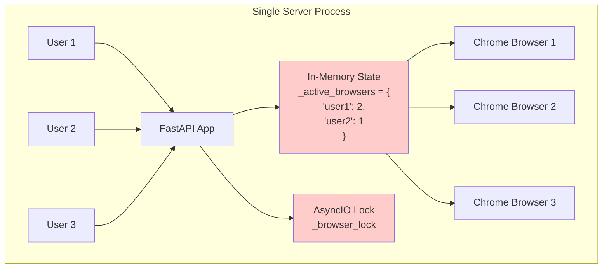
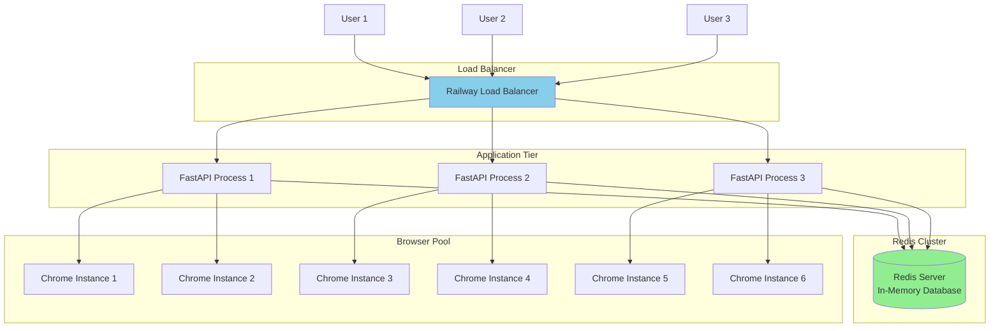
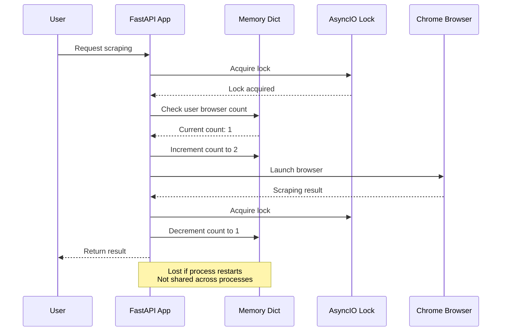
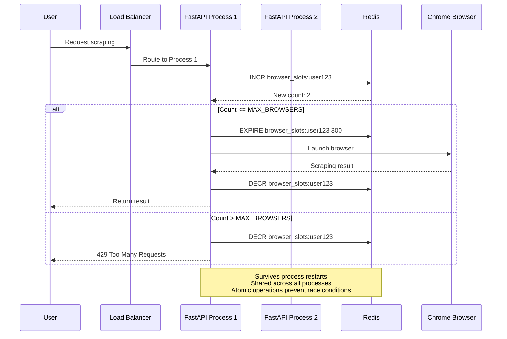
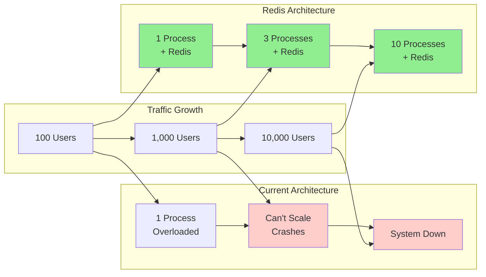
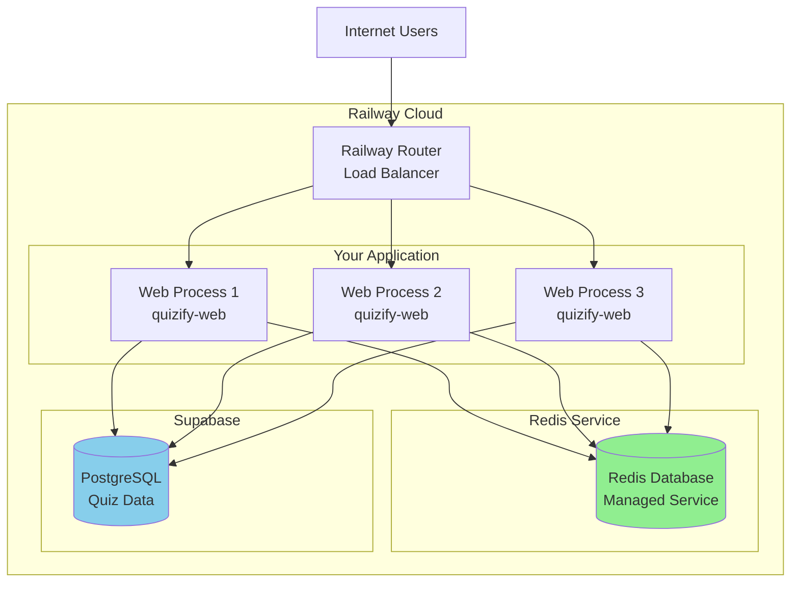
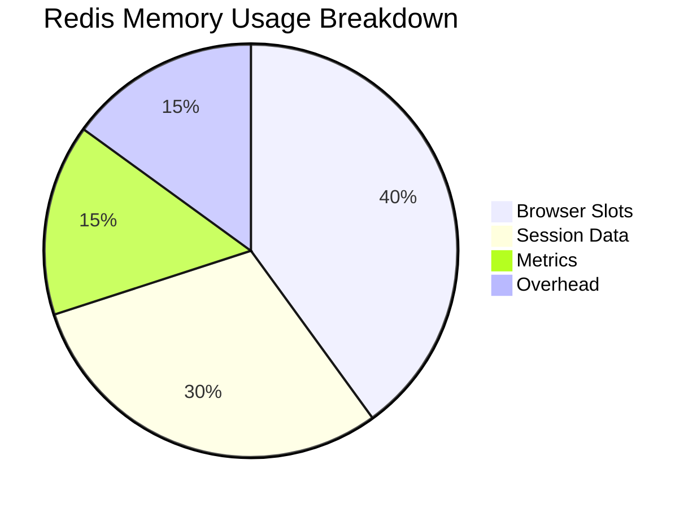

# Redis Architecture Guide for Web Scraping Service

## What is Redis?

**Redis** (Remote Dictionary Server) is an **in-memory data structure store** that can be used as:
- 🗄️ **Database** (but data lives in RAM for speed)
- 🚀 **Cache** (temporary fast storage)
- 📨 **Message broker** (for pub/sub messaging)
- 🔒 **Session store** (for distributed applications)

### Key Characteristics:
- **Lightning Fast**: Data stored in RAM (1000x faster than disk)
- **Persistent**: Can save to disk for durability
- **Atomic Operations**: Thread-safe operations built-in
- **Data Structures**: Strings, Lists, Sets, Hashes, Sorted Sets, etc.
- **Distributed**: Works across multiple servers/processes

---

## Current Architecture Problems

### Before: Single-Process Memory (Current Implementation)



**Problems with Current Architecture:**
- ❌ **Single Point of Failure**: If process crashes, all state lost
- ❌ **No Scalability**: Can't run multiple processes/servers
- ❌ **Memory Loss**: State resets on deployment/restart
- ❌ **Inefficient**: Under-utilizes server resources

---

## After: Multi-Process with Redis

### Distributed Architecture with Redis



---

## Detailed Flow Comparison

### Current Flow (Single Process)



### New Flow (Redis-Backed)



---

## Redis Data Structures for Browser Management

### 1. Simple Counter Approach
```redis
# Key: browser_slots:{user_id}
# Value: Current browser count
# TTL: 300 seconds (auto-cleanup)

SET browser_slots:user123 0
INCR browser_slots:user123    # Returns: 1
INCR browser_slots:user123    # Returns: 2
EXPIRE browser_slots:user123 300
```

### 2. Advanced Session Tracking
```redis
# Hash for detailed session info
HMSET browser_session:user123:session456 user_id user123 started_at 1697712000 url "https://example.com" process_id "railway-process-1"

# Set for active sessions per user
SADD active_sessions:user123 session456

# Get count
SCARD active_sessions:user123  # Returns: 1
```

---

## Implementation Benefits

### Performance Comparison

| Operation | Current (Memory) | Redis (Network) | Improvement |
|-----------|------------------|-----------------|-------------|
| Single Process | 0.001ms | 0.1ms | Still very fast |
| Multi-Process | ❌ Broken | ✅ Works | Enables scaling |
| Process Restart | ❌ Lost state | ✅ Preserved | High availability |
| Concurrent Users | Limited | Unlimited | Better scaling |

### Scalability Scenarios



---

## Code Implementation

### Current Implementation (Problematic)
```python
# ❌ Single-process only
import asyncio
from collections import defaultdict
from fastapi import HTTPException

_active_browsers = defaultdict(int)
_browser_lock = asyncio.Lock()

async def _acquire_browser_slot(user_id: str) -> None:
    async with _browser_lock:  # Only works within one process
        current_count = _active_browsers[user_id]
        if current_count >= MAX_CONCURRENT_BROWSERS:
            raise HTTPException(status_code=429)
        _active_browsers[user_id] += 1
```

### Redis Implementation (Scalable)
```python
# ✅ Multi-process compatible
import os
import uuid
from datetime import datetime
import redis.asyncio as redis
from fastapi import HTTPException
from services.logger import app_logger as logger

async def _acquire_browser_slot_redis(user_id: str) -> str:
    """
    Acquire browser slot using Redis for distributed coordination.
    Returns session_id for tracking.
    """
    MAX_CONCURRENT_BROWSERS = 3  # Define the constant
    redis_client = redis.from_url(os.environ.get('REDIS_URL'))
    session_id = str(uuid.uuid4())
    key = f"browser_slots:{user_id}"
    
    try:
        # Atomic increment and check
        current_count = await redis_client.incr(key)
        
        if current_count > MAX_CONCURRENT_BROWSERS:
            # Rollback the increment
            await redis_client.decr(key)
            raise HTTPException(
                status_code=429,
                detail="Too many concurrent browser sessions"
            )
        
        # Set expiration for cleanup (5 minutes)
        await redis_client.expire(key, 300)
        
        # Store session details
        session_key = f"browser_session:{user_id}:{session_id}"
        session_data = {
            "started_at": datetime.utcnow().isoformat(),
            "process_id": os.environ.get('RAILWAY_REPLICA_ID', 'unknown')
        }
        await redis_client.hset(session_key, session_data)
        await redis_client.expire(session_key, 300)
        
        logger.info(f"Browser slot acquired: {current_count}/{MAX_CONCURRENT_BROWSERS}")
        return session_id
        
    except redis.RedisError as e:
        logger.error(f"Redis error acquiring slot: {e}")
        # Fallback to memory-based tracking
        return await _acquire_browser_slot_memory(user_id)

async def _release_browser_slot_redis(user_id: str, session_id: str) -> None:
    """Release browser slot using Redis."""
    MAX_CONCURRENT_BROWSERS = 3  # Define the constant
    redis_client = redis.from_url(os.environ.get('REDIS_URL'))
    
    try:
        key = f"browser_slots:{user_id}"
        session_key = f"browser_session:{user_id}:{session_id}"
        
        # Decrement counter
        remaining = await redis_client.decr(key)
        
        # Clean up session info
        await redis_client.delete(session_key)
        
        # Remove key if no active sessions
        if remaining <= 0:
            await redis_client.delete(key)
            
        logger.info(f"Browser slot released: {remaining}/{MAX_CONCURRENT_BROWSERS}")
        
    except redis.RedisError as e:
        logger.error(f"Redis error releasing slot: {e}")
```

---

## Deployment Architecture

### Railway Deployment with Redis



### Environment Variables
```bash
# .env
REDIS_URL=redis://red-xxxxx:6379  # Railway provides this
SUPABASE_URL=https://your-project.supabase.co
SUPABASE_KEY=your-supabase-key

# Railway automatically sets:
RAILWAY_REPLICA_ID=web-1  # Unique process identifier
PORT=3000
```

---

## Migration Strategy

### Phase 1: Add Redis Support (Backwards Compatible)
```python
import os
from services.logger import app_logger as logger

async def _acquire_browser_slot(user_id: str) -> str:
    """Smart fallback: Redis first, memory backup."""
    redis_url = os.environ.get('REDIS_URL')
    
    if redis_url:
        try:
            return await _acquire_browser_slot_redis(user_id)
        except Exception as e:
            logger.warning(f"Redis unavailable, using memory: {e}")
    
    # Fallback to current implementation
    return await _acquire_browser_slot_memory(user_id)
```

### Phase 2: Monitor and Optimize
```python
# Add metrics
await redis_client.incr("metrics:browser_slots_acquired")
await redis_client.incr(f"metrics:user_activity:{user_id}")

# Add alerting
ALERT_THRESHOLD = 100  # Define threshold
total_slots = await redis_client.get("browser_slots:total")
if total_slots and int(total_slots) > ALERT_THRESHOLD:
    logger.warning("High browser usage detected")
```

### Phase 3: Full Redis Migration
- Remove memory fallback
- Add Redis health checks
- Implement Redis clustering for high availability

---

## Cost and Infrastructure

### Redis Hosting Options

| Provider | Cost/Month | Memory | Use Case |
|----------|------------|---------|-----------|
| Railway Redis | $5 | 256MB | Development/Small |
| Railway Redis | $20 | 1GB | Production |
| Redis Cloud | $0 | 30MB | Free tier |
| Self-hosted | Server cost | Unlimited | Enterprise |

### Resource Requirements


**Estimated Memory Usage:**
- Browser slots: ~10KB per user (1000 users = 10MB)
- Session metadata: ~5KB per session
- Cleanup overhead: ~20% of total
- **Total for 1000 concurrent users: ~50MB**

---

## Monitoring and Debugging

### Redis Monitoring Commands
```bash
# Connect to Redis
redis-cli -u $REDIS_URL

# Check current browser slots
KEYS browser_slots:*
GET browser_slots:user123

# Monitor real-time commands
MONITOR

# Check memory usage
INFO memory

# List active sessions
KEYS browser_session:*
```

### Application Metrics
```python
# Add to your logging
stats = await redis_client.info('stats')
logger.info(f"Redis stats: {stats}")

active_keys = await redis_client.keys('browser_slots:*')
logger.info(f"Active browser slots: {len(active_keys)}")
```

---

## Summary: Why Redis Solves Your Problems

### Before Redis (Current Issues):
- ❌ **Broken in production**: Multi-process deployments don't work
- ❌ **Lost state**: Process restarts lose all tracking
- ❌ **Race conditions**: Potential memory corruption under load
- ❌ **No observability**: Can't see cross-process usage

### After Redis (Solutions):
- ✅ **Production ready**: Works across unlimited processes
- ✅ **Persistent state**: Survives deployments and crashes
- ✅ **Atomic operations**: Built-in thread safety
- ✅ **Real-time monitoring**: See usage across all instances
- ✅ **Horizontal scaling**: Add processes without coordination issues
- ✅ **Performance**: Sub-millisecond operations
- ✅ **Reliability**: Battle-tested by millions of applications

### Implementation Effort:
- **Time**: 2-4 hours for basic implementation
- **Risk**: Low (fallback to current system)
- **Complexity**: Medium (Redis is well-documented)
- **Benefit**: High (enables true production scaling)

**Recommendation**: Start with Railway Redis addon (~$5/month) for immediate production benefits.