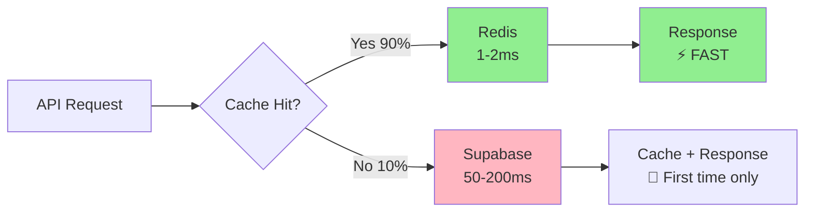
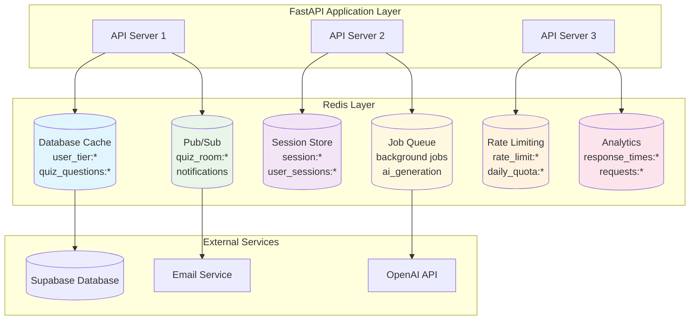

# Redis Complete Architecture for Quizify

## Overview: Redis Beyond Browser Management

Redis can dramatically improve your entire Quizify application across multiple domains:

1. **Database Query Caching** - Cache expensive Supabase queries
2. **Session Management** - Store user sessions and auth tokens
3. **Rate Limiting** - Prevent API abuse and quota enforcement
4. **Real-time Features** - Pub/Sub for live quiz taking
5. **Background Job Queue** - Async AI quiz generation
6. **Performance Analytics** - Track response times and usage

---

## 1. Database Query Caching

### Current Problem
```python
# Every request hits Supabase - SLOW!
def get_user_tier_info(user_id: str):
    result = supabase.table("user_tier_info").select("*").eq("id", user_id).single()
    return result  # 50-200ms database roundtrip EVERY TIME
```

### Redis Solution
```python
import redis.asyncio as redis
import json
from datetime import timedelta

class DatabaseCache:
    def __init__(self):
        self.redis = redis.from_url(os.getenv("REDIS_URL"))
    
    async def get_user_tier_info(self, user_id: str):
        # Try cache first (1-2ms)
        cache_key = f"user_tier:{user_id}"
        cached = await self.redis.get(cache_key)
        
        if cached:
            return json.loads(cached)
        
        # Cache miss - fetch from Supabase (50-200ms)
        result = supabase.table("user_tier_info").select("*").eq("id", user_id).single()
        
        # Cache for 5 minutes
        await self.redis.setex(
            cache_key, 
            timedelta(minutes=5), 
            json.dumps(result.data)
        )
        
        return result.data

# Usage in handlers
cache = DatabaseCache()

async def create_quiz(request: QuizRequest, user: User):
    # 50x faster than direct Supabase call!
    user_tier = await cache.get_user_tier_info(user.id)
    
    if user_tier["quota_exceeded"]:
        raise HTTPException(status_code=429, detail="Quota exceeded")
```

### Performance Impact


**Result:** 90% of requests become 50x faster!

---

## 2. Advanced Caching Strategies

### Quiz Content Caching
```python
class QuizCache:
    async def cache_quiz_questions(self, quiz_id: str, questions: list):
        """Cache generated quiz questions"""
        cache_key = f"quiz_questions:{quiz_id}"
        await self.redis.setex(
            cache_key,
            timedelta(hours=24),  # Quiz questions rarely change
            json.dumps(questions)
        )
    
    async def cache_user_quiz_history(self, user_id: str, quizzes: list):
        """Cache user's recent quizzes"""
        cache_key = f"user_quizzes:{user_id}"
        await self.redis.setex(
            cache_key,
            timedelta(minutes=15),  # Update frequently
            json.dumps(quizzes)
        )
    
    async def cache_popular_content(self, url: str, content: str):
        """Cache scraped web content"""
        cache_key = f"scraped_content:{hashlib.md5(url.encode()).hexdigest()}"
        await self.redis.setex(
            cache_key,
            timedelta(hours=6),  # Web content changes moderately
            content
        )
```

### Smart Cache Invalidation
```python
class SmartCache:
    async def invalidate_user_cache(self, user_id: str):
        """Clear all cached data when user updates profile/tier"""
        patterns = [
            f"user_tier:{user_id}",
            f"user_quizzes:{user_id}",
            f"user_submissions:{user_id}*"
        ]
        
        for pattern in patterns:
            keys = await self.redis.keys(pattern)
            if keys:
                await self.redis.delete(*keys)
    
    async def warm_cache(self, user_id: str):
        """Pre-populate cache with likely-needed data"""
        # Fetch and cache user data proactively
        await self.get_user_tier_info(user_id)
        await self.get_user_quiz_history(user_id)
```

---

## 3. Session & Authentication Enhancement

### Current JWT Limitations
- JWT tokens can't be revoked instantly
- No way to track active sessions
- Can't implement "logout all devices"

### Redis Session Store
```python
class SessionManager:
    async def create_session(self, user_id: str, jwt_token: str, device_info: dict):
        """Store active session in Redis"""
        session_id = str(uuid.uuid4())
        session_data = {
            "user_id": user_id,
            "jwt_token": jwt_token,
            "device_info": device_info,
            "created_at": datetime.utcnow().isoformat(),
            "last_activity": datetime.utcnow().isoformat()
        }
        
        # Store session (expires in 7 days)
        await self.redis.setex(
            f"session:{session_id}",
            timedelta(days=7),
            json.dumps(session_data)
        )
        
        # Track user's active sessions
        await self.redis.sadd(f"user_sessions:{user_id}", session_id)
        
        return session_id
    
    async def validate_session(self, session_id: str) -> bool:
        """Check if session is still valid"""
        session_data = await self.redis.get(f"session:{session_id}")
        if not session_data:
            return False
        
        # Update last activity
        session = json.loads(session_data)
        session["last_activity"] = datetime.utcnow().isoformat()
        await self.redis.setex(
            f"session:{session_id}",
            timedelta(days=7),
            json.dumps(session)
        )
        
        return True
    
    async def logout_all_devices(self, user_id: str):
        """Instantly invalidate all user sessions"""
        session_ids = await self.redis.smembers(f"user_sessions:{user_id}")
        
        # Delete all sessions
        for session_id in session_ids:
            await self.redis.delete(f"session:{session_id}")
        
        # Clear session set
        await self.redis.delete(f"user_sessions:{user_id}")
```

---

## 4. Rate Limiting & Quota Management

### Advanced Rate Limiting
```python
class RateLimiter:
    async def check_rate_limit(self, user_id: str, endpoint: str, limit: int, window: int):
        """Sliding window rate limiting"""
        now = datetime.utcnow().timestamp()
        key = f"rate_limit:{endpoint}:{user_id}"
        
        # Use sorted set for sliding window
        pipe = self.redis.pipeline()
        
        # Remove old entries
        pipe.zremrangebyscore(key, 0, now - window)
        
        # Count current requests
        pipe.zcard(key)
        
        # Add current request
        pipe.zadd(key, {str(uuid.uuid4()): now})
        
        # Set expiration
        pipe.expire(key, window)
        
        results = await pipe.execute()
        current_count = results[1]
        
        if current_count >= limit:
            raise HTTPException(
                status_code=429,
                detail=f"Rate limit exceeded: {current_count}/{limit} requests per {window}s"
            )
    
    async def check_daily_quota(self, user_id: str, tier_limits: dict):
        """Daily quota tracking"""
        today = datetime.utcnow().strftime("%Y-%m-%d")
        key = f"daily_quota:{user_id}:{today}"
        
        current_usage = await self.redis.get(key) or 0
        current_usage = int(current_usage)
        
        user_tier = await self.get_user_tier_info(user_id)
        daily_limit = tier_limits.get(user_tier["account_tier"], 5)
        
        if current_usage >= daily_limit:
            raise HTTPException(
                status_code=429,
                detail=f"Daily quota exceeded: {current_usage}/{daily_limit}"
            )
        
        # Increment usage
        await self.redis.incr(key)
        await self.redis.expire(key, 86400)  # 24 hours
        
        return {
            "used": current_usage + 1,
            "limit": daily_limit,
            "remaining": daily_limit - current_usage - 1
        }
```

---

## 5. Real-time Features with Pub/Sub

### Live Quiz Taking
```python
class LiveQuizManager:
    async def start_quiz_session(self, quiz_id: str, user_id: str):
        """Start a live quiz session"""
        session_data = {
            "quiz_id": quiz_id,
            "user_id": user_id,
            "started_at": datetime.utcnow().isoformat(),
            "current_question": 0,
            "answers": {}
        }
        
        session_key = f"live_quiz:{quiz_id}:{user_id}"
        await self.redis.setex(session_key, timedelta(hours=2), json.dumps(session_data))
        
        # Notify quiz room
        await self.redis.publish(
            f"quiz_room:{quiz_id}",
            json.dumps({"type": "user_joined", "user_id": user_id})
        )
    
    async def submit_answer(self, quiz_id: str, user_id: str, question_id: str, answer: str):
        """Submit answer in real-time"""
        session_key = f"live_quiz:{quiz_id}:{user_id}"
        session_data = await self.redis.get(session_key)
        
        if session_data:
            session = json.loads(session_data)
            session["answers"][question_id] = {
                "answer": answer,
                "submitted_at": datetime.utcnow().isoformat()
            }
            
            await self.redis.setex(session_key, timedelta(hours=2), json.dumps(session))
            
            # Real-time notification to quiz room
            await self.redis.publish(
                f"quiz_room:{quiz_id}",
                json.dumps({
                    "type": "answer_submitted",
                    "user_id": user_id,
                    "question_id": question_id
                })
            )

# WebSocket handler for live updates
async def quiz_websocket_handler(websocket: WebSocket, quiz_id: str):
    await websocket.accept()
    
    # Subscribe to quiz room updates
    pubsub = redis_client.pubsub()
    await pubsub.subscribe(f"quiz_room:{quiz_id}")
    
    try:
        while True:
            message = await pubsub.get_message(ignore_subscribe_messages=True)
            if message:
                await websocket.send_text(message["data"])
    except WebSocketDisconnect:
        await pubsub.unsubscribe(f"quiz_room:{quiz_id}")
```

---

## 6. Background Job Queue

### Async AI Quiz Generation
```python
from rq import Queue
from redis import Redis

class BackgroundJobs:
    def __init__(self):
        self.redis_conn = Redis.from_url(os.getenv("REDIS_URL"))
        self.queue = Queue(connection=self.redis_conn)
    
    def queue_quiz_generation(self, user_id: str, content: str, preferences: dict):
        """Queue AI quiz generation as background job"""
        job = self.queue.enqueue(
            generate_quiz_async,
            user_id=user_id,
            content=content,
            preferences=preferences,
            job_timeout='5m'
        )
        
        return {"job_id": job.id, "status": "queued"}
    
    def get_job_status(self, job_id: str):
        """Check background job status"""
        job = self.queue.fetch_job(job_id)
        
        if not job:
            return {"status": "not_found"}
        
        return {
            "status": job.get_status(),
            "progress": job.meta.get("progress", 0),
            "result": job.result if job.is_finished else None,
            "error": str(job.exc_info) if job.is_failed else None
        }

# Background worker function
async def generate_quiz_async(user_id: str, content: str, preferences: dict):
    """Generate quiz in background with progress updates"""
    job = get_current_job()
    
    # Update progress
    job.meta["progress"] = 25
    job.save_meta()
    
    # Generate quiz with AI
    quiz_data = await ai_service.generate_quiz(content, preferences)
    
    job.meta["progress"] = 75
    job.save_meta()
    
    # Save to database
    quiz_id = await save_quiz_to_db(user_id, quiz_data)
    
    job.meta["progress"] = 100
    job.save_meta()
    
    # Notify user via WebSocket/email
    await notify_quiz_ready(user_id, quiz_id)
    
    return {"quiz_id": quiz_id, "status": "completed"}
```

---

## 7. Performance Analytics & Monitoring

### Real-time Metrics
```python
class AnalyticsCollector:
    async def track_request(self, endpoint: str, user_id: str, response_time: float):
        """Track API performance metrics"""
        timestamp = datetime.utcnow().timestamp()
        
        # Time series data for response times
        await self.redis.zadd(
            f"response_times:{endpoint}",
            {f"{user_id}:{timestamp}": response_time}
        )
        
        # Keep only last 24 hours of data
        yesterday = timestamp - 86400
        await self.redis.zremrangebyscore(f"response_times:{endpoint}", 0, yesterday)
        
        # Daily counters
        today = datetime.utcnow().strftime("%Y-%m-%d")
        await self.redis.incr(f"requests:{endpoint}:{today}")
        await self.redis.expire(f"requests:{endpoint}:{today}", 86400)
    
    async def get_performance_stats(self, endpoint: str):
        """Get real-time performance statistics"""
        response_times_key = f"response_times:{endpoint}"
        
        # Get all response times from last 24 hours
        response_times = await self.redis.zrange(response_times_key, 0, -1, withscores=True)
        times = [score for _, score in response_times]
        
        if not times:
            return {"error": "No data available"}
        
        return {
            "avg_response_time": sum(times) / len(times),
            "min_response_time": min(times),
            "max_response_time": max(times),
            "total_requests": len(times),
            "p95_response_time": self.percentile(times, 95),
            "p99_response_time": self.percentile(times, 99)
        }
    
    def percentile(self, data: list, percentile: int) -> float:
        """Calculate percentile"""
        sorted_data = sorted(data)
        index = int((percentile / 100) * len(sorted_data))
        return sorted_data[min(index, len(sorted_data) - 1)]
```

---

## 8. Complete Redis Integration Architecture



---

## 9. Implementation Priority

### Phase 1: Quick Wins (Week 1)
```bash
# 1. Database caching - immediate 50x speedup
pip install redis[hiredis]
# Implement user_tier_info caching

# 2. Rate limiting - prevent abuse
# Implement endpoint rate limits
```

### Phase 2: Enhanced Features (Week 2)
```bash
# 3. Session management - better security
# 4. Quiz content caching - faster quiz loading
```

### Phase 3: Advanced Features (Week 3)
```bash
# 5. Background jobs - async AI generation
# 6. Real-time features - live quiz taking
# 7. Analytics - performance monitoring
```

### Railway Redis Setup
```bash
# Add Redis addon to Railway project (~$5/month)
railway add redis

# Environment variables automatically added:
# REDIS_URL=redis://...
# REDIS_PRIVATE_URL=redis://...
```

---

## Performance Impact Summary

| Feature | Before Redis | With Redis | Improvement |
|---------|-------------|------------|-------------|
| User tier lookup | 50-200ms | 1-2ms | **50x faster** |
| Quiz history | 100-300ms | 2-5ms | **30x faster** |
| Rate limiting | Database queries | Memory ops | **100x faster** |
| Session validation | JWT decode only | Full session tracking | **Security boost** |
| Quiz generation | Synchronous blocking | Background async | **User experience** |
| Real-time features | Not possible | WebSocket + Pub/Sub | **New capability** |

**Total Cost:** ~$5/month for Redis addon
**Total Benefit:** Massive performance gains + new features + better user experience

This transforms Quizify from a simple API to a **high-performance, real-time, scalable platform**!