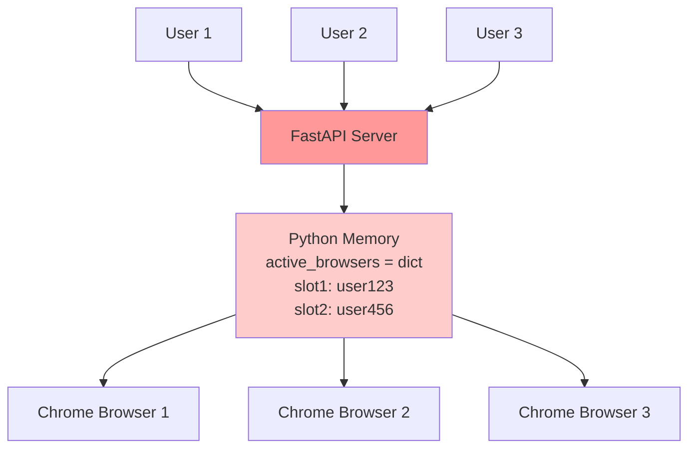
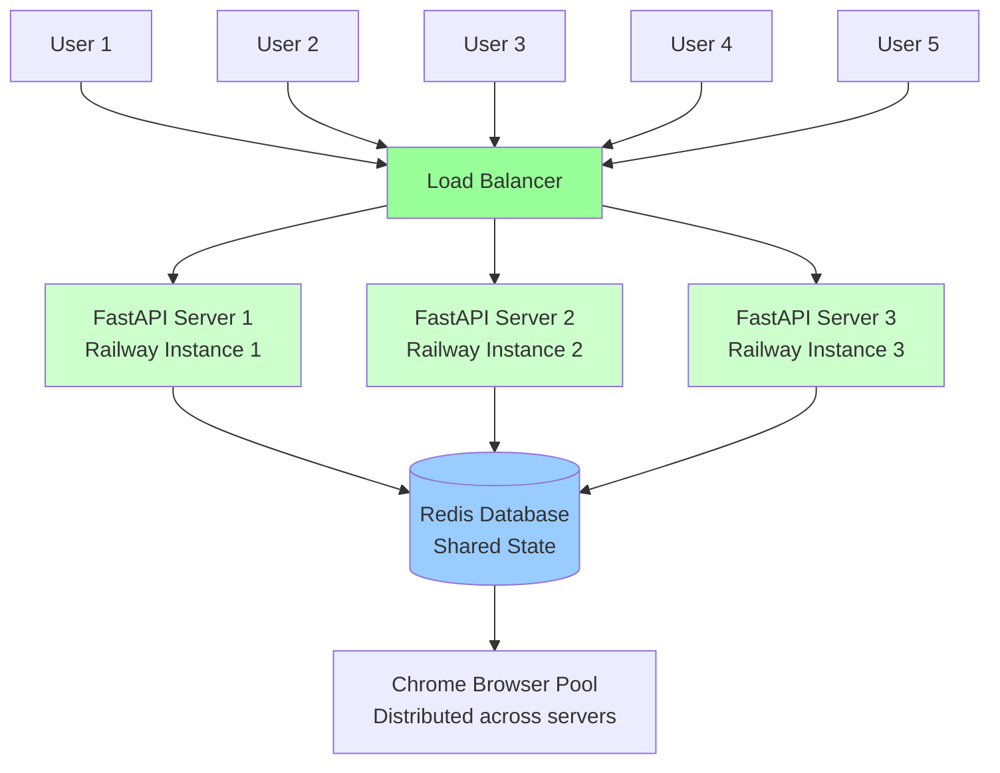

# Scaling Comparison: With vs Without Redis

## Current Architecture (Single Instance)

**Limitations:**
- ❌ Only 1 server can handle all traffic
- ❌ If server crashes, all data lost
- ❌ Can't scale beyond 1 machine's capacity

## Redis Architecture (Multiple Instances)

**Benefits:**
- ✅ Multiple servers handle traffic
- ✅ If one server crashes, others continue
- ✅ Can scale to handle 1000+ concurrent users